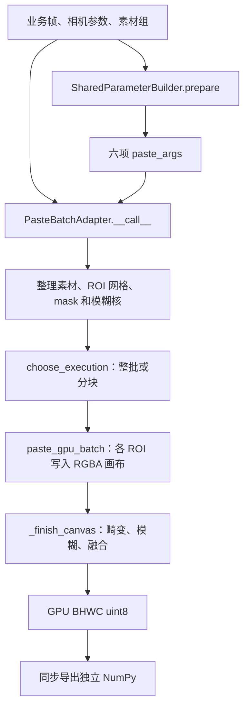

# 代码阅读与修改指南

当前版本 `2026-10-21-perf4.2-readable`。这是 GPU 贴图库和基准工具，不含视频解码、编码、推流或常驻服务。
这里的 **B（路数）是同一画面/布局下的素材组数**；每组产生一张结果，不等同于任意独立摄像机的并发数。

## 先从哪里读

1. [shared_paste_example.py](shared_paste_example.py)：worker 初始化、每帧共享准备和业务调用位置。
2. [paste_gpu_batch_adapter.py](paste_gpu_batch_adapter.py) 的 `PasteBatchAdapter.__call__`：从业务输入到 NumPy 输出的主流程。
3. [paste_gpu_batch.py](paste_gpu_batch.py) 的 `paste_gpu_batch` / `_finish_canvas`：纯 Tensor 运算与后端选择。
4. 再按需求查看共享几何、缓存、执行策略或具体 Triton 内核。

动态业务接入可直接参考 [dynamic_paste_example.py](dynamic_paste_example.py)：`initialize_dynamic_worker` 调用一次，随后复用对象调用 `render_dynamic_frame`，B 由当前素材组列表决定。示例不提供合成业务回调；B=0由调度方跳过，B1继续返回HWC。已用合成测试数据验证1→3→8→5→12→1与整批逐字节一致，以及旧输出存活、way专用无广告优先和空B拒绝，记录见 `results/dynamic_business_example.json`。



## 文件职责

| 文件 | 负责什么 | 适合在这里修改什么 |
|---|---|---|
| `shared_paste_example.py` | 业务对象接入，初始化 builder/adapter | worker 接入方式 |
| `paste_camera_filter.py` | CPU 相机历史选择、滤波、调用业务运动估计 | 相机数据校验和滤波；行为变更须单独验收 |
| `paste_shared_params.py` | 共享畸变网格、ROI 网格、精确 sigma 核缓存 | 共享准备和缓存实现 |
| `paste_shared_types.py` | `MotionKernelSpec`：二维核与已验证的一维因子 | 共享数据契约 |
| `paste_gpu_batch_adapter.py` | 输入布局、素材缓存、执行编排、NumPy 所有权 | 业务接口适配和输出策略 |
| `paste_execution_policy.py` | 离线实测配置的匹配与回退 | 新硬件/布局/B 的实测策略 |
| `paste_gpu_batch.py` | 纯 Tensor 贴图流程，batch/bucketed，后端路由 | GPU 阶段组织和参考路径 |
| `paste_gpu_kernels.py` | Triton ROI 采样、融合、dense 模糊 | 对应数值内核 |
| `paste_gaussian_kernels.py` | 横纵可分离模糊与最终融合 | 两阶段启动参数和内核 |
| `paste_shared_kernels.py` | Triton 畸变和 ROI 网格生成 | 几何网格内核 |

运行时代码不依赖 benchmark 或测试文件；共享准备和 adapter 共同使用 `MotionKernelSpec`。
保留平铺文件和原导入路径，已有业务代码不需要迁移包名。

## 一帧如何走完

`setup_shared_paste` 在 worker 内执行一次；builder 和 adapter 后续复用。
`prepare_shared_paste_args` 每帧读取实时 K/畸变/运动参数，输出以下原有六项元组：

```python
(device, distortion_grid, filtered_coefficients,
 motion_kernel, mask_canvas, warp_grid_dict)
```

`motion_kernel` 可以是原 Tensor，或带已验证因子的 `MotionKernelSpec`。元组顺序保持兼容。
实际素材尺寸明确后，adapter 才生成每个广告位的 ROI 网格。

`PasteBatchAdapter.__call__` 现在主要编排以下步骤：

| 阶段 | 方法 | 边界 |
|---|---|---|
| 选择输入 | `_groups`、`_ad_parameters` | 确定 B 和当前 way 的广告位 |
| 无广告返回 | `_render_background_only` | 不要求 `paste_args` 有效 |
| 背景与素材 | `_prepare_frame`、`_collect_ads` | 规范为 float32 Tensor；复用素材缓存 |
| ROI 输入 | `_prepare_warp_inputs` | 根据实际素材尺寸准备 grid 与透明度 |
| 全图输入 | `_prepare_canvas_inputs`、`_prepare_motion_kernel` | 畸变、mask、共享/逐组核 |
| 选策略 | `_select_execution` | 记录 `last_execution`；未知配置回退整批 |
| 执行与输出 | `_render_prepared` | batch/bucketed/分块；NumPy 或显式 Tensor 输出 |

GPU 核心先按广告位顺序覆盖 RGBA 画布，再做全图畸变、模糊、背景/mask 融合和 uint8 转换。
`_finish_canvas` 明确区分 `torch`、dense `triton` 和 `separable` 三条模糊路径。
不可交换 ROI 写入顺序、alpha 运算顺序或模糊位置，它们会改变画面。

## 形状与坐标约定

`H/W` 是背景高宽，`h/w` 是单个素材或 ROI 高宽，`N` 是可广播的 1 或 B。
一个广告位在不同素材组中必须具有相同源尺寸；不同广告位可以尺寸不同。

| 数据 | 核心形状 | 含义 |
|---|---|---|
| 背景 | `[N,3,H,W]` | float32，RGB/BGR 顺序原样保留 |
| 每位素材 | `[B,4,h,w]` | RGB 和原始 alpha 均为 0～255 |
| 每位 grid | `[N,roi_h,roi_w,2]` | 反向采样坐标 |
| 畸变 grid | `[N,H,W,2]` | 全图反向采样坐标 |
| mask | 可广播到 `[B,3,H,W]` | 1 保留背景，0 允许广告 |
| 透明度 | 可广播到 ROI 的 `[B,1,h,w]` | 0～1 |
| dense 核 | `[4,1,kh,kw]` 或 `[B,4,1,kh,kw]` | 共享或逐组二维卷积核 |
| 可分离因子 | `ky[kh]`、`kx[kw]` | 两个 FP32 一维向量，共享到组/通道 |
| 核心输出 | `[B,H,W,3]` | GPU uint8 |
| 默认业务输出 | B1 为 `[H,W,3]`，多路为 `[B,H,W,3]` | 同步 NumPy uint8；可显式关闭单组压缩 |

`bbox=(x1,y1,x2,y2)` 右下不包含，必须在画布内。共享 ROI 建网格使用 ROI 局部坐标和 `z + 1e-8`。
`normalization="legacy"`、`camera_index_policy="legacy"` 和 `legacy_alpha=True` 保持历史画面；其它值会改变语义。
Tensor 的 stride 和广播视图有实际性能意义，不要为了整洁随意加入 `.contiguous()`。

## 缓存与输出生命周期

- 素材缓存由尺寸、素材身份、版本、设备、B 等区分；原地修改素材后递增 `imgs_raw_version` 或显式失效。
- Gaussian 核按精确 sigma 和回调/配置版本缓存；没有 sigma 量化。相同 `frame_id` 的 K、畸变、矩阵仍可能变化，因此不缓存整帧几何值。
- 每次 NumPy 输出拥有独立存储。固定页路径直接返回 host Tensor 的 NumPy 视图，数组持有其底层 Tensor。
- 分块路径仍在调用方计算流串行计算；内部复制流等对应事件后复制。GPU 源和 host 结果一直存活到复制完成，正常返回与异常退出都同步复制流。
- 每个 worker 使用自己的实例，调用方按同一计算流串行调用。跨流生产输入需先建立依赖。

`batch_chunk_size="auto"` 只匹配离线表；`0` 整批；正整数手动分块。当前表、限制及历史性能见 [动态路数报告](DYNAMIC_BATCH_REVIEW.md)。
重构没有扩展自动启用范围，也没有默认启用可分离模糊。

## 基准与回归工具

| 命令 | 文件 | 验证范围 |
|---|---|---|
| `scripts/run.ps1 shared` | `benchmark_shared_paste.py` | 含共享准备与 NumPy 的完整调用 |
| `scripts/run.ps1 batch` | `benchmark_paste_gpu_batch.py` | 核心、adapter、dense 内核及诊断 |
| `scripts/run.ps1 check` | `test_dynamic_batch.py` | 广播、尾块、动态 B、缓存和输出生命周期 |
| `scripts/run.ps1 compare` | `benchmark_dynamic_comparison.py` | 隔离加载旧源码，对照当前完整调用 |
| `scripts/run.ps1 dynamic` | `benchmark_dynamic_batch.py` | 不同分块/启动配置筛选 |
| `scripts/run.ps1 tune` | `benchmark_blur_tuning.py` | 单独模糊内核调参；不是完整耗时 |

`benchmark_support.py` 只共享报告、轮换顺序和同步计时；不放业务计算。
基准使用合成运动/sigma/Gaussian 回调，不代表真实业务。不要把独立阶段计时相加，也不要把跨轮数字当收益。

## 后续迭代习惯

格式统一为 Ruff 0.14.1、100 列、UTF-8/LF、Python 3.9 语法目标；实际 GPU 环境仍是 Python 3.12。
格式与 lint 工具使用独立 uv 工具环境，不改变 GPU 运行依赖：

```powershell
.\scripts\lint.ps1          # 只检查
.\scripts\lint.ps1 -Fix     # 格式化后检查；不自动更改语义
.\scripts\run.ps1 check --device cuda:0 --profile-checks
```

新增处理优先放在负责该阶段的现有函数附近。内核保留数学坐标和 stride 命名；host 代码使用能说明职责的名称。
更改执行策略必须补完整 NumPy 对照；更改数值核必须补原算法/旧源码对照，不依靠逐轮放宽容差。
此次重构范围与验收见 [READABILITY_REVIEW.md](READABILITY_REVIEW.md)。
