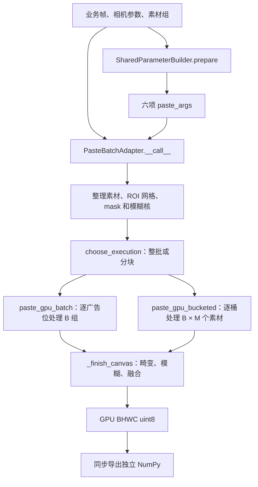

# 代码阅读与修改指南

当前版本 `2026-10-21-perf4.5-streaming`。这是 GPU 贴图库和基准工具，不含视频解码、编码、推流或常驻服务。
这里的 **B（路数）是同一画面/布局下的素材组数**；每组产生一张结果，不等同于任意独立摄像机的并发数。
本轮直播资源生命周期、测量方法及验收状态见 [STREAMING_REVIEW.md](STREAMING_REVIEW.md)。[BUCKETED_OPTIMIZATION_REVIEW.md](BUCKETED_OPTIMIZATION_REVIEW.md) 保留 perf4.4 桶优化结果；[BACKEND_COMPARISON_REVIEW.md](BACKEND_COMPARISON_REVIEW.md) 保留更早的旧桶观察。

## 先从哪里读

1. [shared_paste_example.py](shared_paste_example.py)：worker 初始化、每帧共享准备和业务调用位置。
2. [paste_gpu_batch_adapter.py](paste_gpu_batch_adapter.py) 的 `PasteBatchAdapter.__call__`：从业务输入到 NumPy 输出的主流程。
3. [paste_gpu_batch.py](paste_gpu_batch.py) 的 `paste_gpu_batch` / `_finish_canvas`：纯 Tensor 运算与后端选择。
4. 再按需求查看共享几何、缓存、执行策略或具体 Triton 内核。

动态业务接入可直接参考 [dynamic_paste_example.py](dynamic_paste_example.py)：`initialize_dynamic_worker` 调用一次，随后复用对象调用 `render_dynamic_frame`，B 由当前素材组列表决定。示例不提供合成业务回调；B=0由调度方跳过，B1继续返回HWC。已用合成测试数据验证1→3→8→5→12→1与整批逐字节一致，以及旧输出存活、way专用无广告优先和空B拒绝，记录见 `results/dynamic_business_example.json`。



## 文件职责

| 文件 | 负责什么 | 适合在这里修改什么 |
|---|---|---|
| `shared_paste_example.py` | 业务对象接入，初始化 builder/adapter | worker 接入方式 |
| `paste_camera_filter.py` | CPU 相机历史选择、滤波、可选有界历史容器 | 相机数据校验、历史生命周期；滤波行为变更须单独验收 |
| `paste_shared_params.py` | 共享畸变网格、ROI 网格、精确 sigma 核缓存 | 共享准备和缓存实现 |
| `paste_shared_types.py` | `MotionKernelSpec`：二维核与已验证的一维因子 | 共享数据契约 |
| `paste_gpu_batch_adapter.py` | 输入布局、素材缓存、执行编排、NumPy 所有权 | 业务接口适配和输出策略 |
| `paste_asset_cache.py` | 历史素材 stack 的尺寸/条目/字节 LRU 与源身份引用 | 缓存预算、revision 清理和保留量诊断 |
| `paste_execution_policy.py` | 离线实测配置的匹配与回退 | 新硬件/布局/B 的实测策略 |
| `paste_gpu_batch.py` | 纯 Tensor 贴图流程，batch/bucketed，后端路由 | GPU 阶段组织和参考路径 |
| `paste_gpu_kernels.py` | Triton ROI 采样、融合、dense 模糊 | 对应数值内核 |
| `paste_gaussian_kernels.py` | 横纵可分离模糊与最终融合 | 两阶段启动参数和内核 |
| `paste_shared_kernels.py` | Triton 畸变和 ROI 网格生成 | 几何网格内核 |

运行时代码不依赖 benchmark 或测试文件；共享准备和 adapter 共同使用 `MotionKernelSpec`。
保留平铺文件和原导入路径，已有业务代码不需要迁移包名。

## 一帧如何走完

`setup_shared_paste` 在 worker 内执行一次；builder 和 adapter 后续复用。
`prepare_shared_paste_args` 每帧读取实时 K/畸变/运动参数，输出以下原有六项元组：

```python
(device, distortion_grid, filtered_coefficients,
 motion_kernel, mask_canvas, warp_grid_dict)
```

`motion_kernel` 可以是原 Tensor，或带已验证因子的 `MotionKernelSpec`。元组顺序保持兼容。
实际素材尺寸明确后，adapter 才生成每个广告位的 ROI 网格。

`PasteBatchAdapter.__call__` 现在主要编排以下步骤：

| 阶段 | 方法 | 边界 |
|---|---|---|
| 选择输入 | `_groups`、`_ad_parameters` | 确定 B 和当前 way 的广告位 |
| 无广告返回 | `_render_background_only` | 不要求 `paste_args` 有效 |
| 背景与素材 | `_prepare_frame`、`_collect_ads` | 规范为 float32 Tensor；复用素材缓存 |
| ROI 输入 | `_prepare_warp_inputs` | 根据实际素材尺寸准备 grid 与透明度 |
| 全图输入 | `_prepare_canvas_inputs`、`_prepare_motion_kernel` | 畸变、mask、共享/逐组核 |
| 选策略 | `_select_execution` | 记录 `last_execution`；未知配置回退整批 |
| 执行与输出 | `_render_prepared` | batch/bucketed/分块；NumPy 或显式 Tensor 输出 |

GPU 核心先按广告位顺序覆盖 RGBA 画布，再做全图畸变、模糊、背景/mask 融合和 uint8 转换。
`_finish_canvas` 明确区分 `torch`、dense `triton` 和 `separable` 三条模糊路径。
不可交换 ROI 写入顺序、alpha 运算顺序或模糊位置，它们会改变画面。

输入的局部形状、广播和设备契约由对应准备阶段校验，adapter 不再在进入 core 前重复扫描同一组已准备 Tensor。独立调用 core 的代码仍须使用公开 `validate_inputs()`。素材图像和 mask/透明度的布局计划只缓存 shape、布局和排列/广播操作等 CPU 元数据；缓存不保存这些动态 map 的值，每次仍应用于当前输入。

batch core 已逐 slot 判断 Triton 支持条件和 padding 模式后，使用私有 `_warp_paste_into_supported` 启动，省去公开包装器的重复支持检查。公开 `warp_paste_into` 仍保留检查；两条入口共用同一展开、stride、启动参数和设备数学。业务代码应调用公开 API，不直接调用这个私有入口。

### batch、bucketed 与分块分别合并什么

`batch` 和 `bucketed` 都先把同一广告位的 B 组素材整理为 `[B,4,src_h,src_w]`。
这里的堆叠发生在**素材组维度 B**；单个广告位在 B 组中的源尺寸必须相同。

| 路径 | 核心 Python 循环 | 一次采样处理的维度 | 如何得到整张画布 |
|---|---|---|---|
| `batch` | 按原顺序逐广告位循环 | 当前广告位的 B 组素材 | 每位 ROI 覆盖写入 `[B,4,H,W]` 画布 |
| `bucketed` | 逐桶循环 | 当前桶的 B × M 个素材，M 是桶内广告位数 | 桶内结果拼成 palette，再按 `canvas_lut` 取回每个画布像素的最终所有者 |

`bucketed` 默认按源高宽分桶，`area_caps` 还可按 ROI 面积细分。每桶素材为
`[B,M,4,src_h,src_w]`，grid 为 `[B,M,L,2]`，L 是补齐后的 ROI 像素容量；
采样时分别展平为 `[B*M,4,src_h,src_w]` 和 `[B*M,1,L,2]`。
因此矩形 ROI 先展平并补齐到 L，而非补齐成统一的最大高宽矩形。
LUT 按原广告位顺序保留最后覆盖者；后位透明像素也会覆盖前位，而不是跳过覆盖。

在可用的 Triton zeros/border 路径中，每桶将 B×M 作为批次，复用 batch 的同一 warp/alpha 内核，
写出 `[B*M,4,1,L]` patch 后再组装 palette/LUT。eager 与 reflection 继续使用原 PyTorch 采样。
这项复用统一采样算术；是否逐字节一致以及是否更快，仍须完整输出对照。

这并未消除外围的逐广告位工作：素材检查/转换、布局规划，以及 grid/透明度的
pad 和 stack 仍包含 slot 循环。当前 adapter 每帧重新打包 grid 和透明度；素材桶可复用缓存。
两条核心路径最终都把 `[B,4,H,W]` 画布交给 `_finish_canvas`，完成相同的全图阶段。

`batch_chunk_size` 切的是 **B 维度**，不会把广告位变成桶。共享相机/核/畸变准备，以及
adapter 的素材收集、ROI grid 和透明度准备，都在分块前执行一次；随后按块切分非广播的
B 维输入，广播到 B 的单份输入继续共享。当前分块执行用于 `batch` 后端，各块包含全部广告位，
块内仍按广告位循环，最后按原组顺序导出 NumPy。

## 形状与坐标约定

`H/W` 是背景高宽，`h/w` 是单个素材或 ROI 高宽，`N` 是可广播的 1 或 B。
一个广告位在不同素材组中必须具有相同源尺寸；不同广告位可以尺寸不同。

| 数据 | 核心形状 | 含义 |
|---|---|---|
| 背景 | `[N,3,H,W]` | float32，RGB/BGR 顺序原样保留 |
| 每位素材 | `[B,4,h,w]` | RGB 和原始 alpha 均为 0～255 |
| 每位 grid | `[N,roi_h,roi_w,2]` | 反向采样坐标 |
| 畸变 grid | `[N,H,W,2]` | 全图反向采样坐标 |
| mask | 可广播到 `[B,3,H,W]` | 1 保留背景，0 允许广告 |
| 透明度 | 可广播到 ROI 的 `[B,1,h,w]` | 0～1 |
| dense 核 | `[4,1,kh,kw]` 或 `[B,4,1,kh,kw]` | 共享或逐组二维卷积核 |
| 可分离因子 | `ky[kh]`、`kx[kw]` | 两个 FP32 一维向量，共享到组/通道 |
| 核心输出 | `[B,H,W,3]` | GPU uint8 |
| 默认业务输出 | B1 为 `[H,W,3]`，多路为 `[B,H,W,3]` | 同步 NumPy uint8；可显式关闭单组压缩 |

`bbox=(x1,y1,x2,y2)` 右下不包含，必须在画布内。共享 ROI 建网格使用 ROI 局部坐标和 `z + 1e-8`。
`normalization="legacy"`、`camera_index_policy="legacy"` 和 `legacy_alpha=True` 保持历史画面；其它值会改变语义。
Tensor 的 stride 和广播视图有实际性能意义，不要为了整洁随意加入 `.contiguous()`。

## 缓存与输出生命周期

- 素材 key 区分有序源身份、版本、设备、B、shape/dtype 和 resize 等配置；原地修改素材后递增 `imgs_raw_version` 或显式失效。revision 精确变化时清旧代历史与当前工作集，不把每个视频帧版本永久留在 LRU 中。
- `paste_asset_cache.py` 的历史 stack 默认受 `max_cached_bytes=512*1024*1024`、`max_cached_sizes` 和 `max_entries_per_size` 三种限制。设字节预算为 0 不保留历史，但仍可复用当前完整素材工作集；`cache_ads=False` 或 revision 为 `None` 才禁用素材复用。
- 当前 `[B,4,h,w]` 工作集独立保留，可超过历史预算；其中同一 Tensor 可能同时被 LRU 引用，并非复制两份。历史条目与当前工作集均强引用对应源对象，防止 Python 复用 `id` 导致错误命中。源对象的底层存储不计入历史 stack 预算，因此预算不等于总内存上限。
- 尺寸缓存是已整理素材的复用，`batch` 同样使用它；缓存命中不表示启用了 `bucketed` 计算分桶。
- `bucketed` 只保留当前一份素材打包缓存，key 为素材 key 加有序桶成员。bbox、ROI 容量或 LUT 变化仍重建布局，但分组不变时复用打包素材；`area_caps` 导致成员分组变化时必须重打包。
- 素材身份/版本、设备、B、源尺寸或顺序变化，以及显式失效、素材缓存 miss，仍使桶素材失效；禁用素材缓存时每帧重打包。grid/透明度始终实时打包，不复用旧几何。
- Gaussian 核在当前 owner/回调/配置版本/device 上下文中按精确 sigma 缓存，默认最多 16 项；切换上下文时清旧项与旧 owner 引用。持续变化的 sigma 仍可能每帧 miss，不量化 sigma 或替换真实回调。相同 `frame_id` 的 K、畸变、矩阵仍可能变化，因此不缓存整帧几何值。
- `BoundedCameraHistory` 由业务显式创建一次、按单调帧号添加独立记录，过滤器仅对此类型按邻域直接查询。容量计记录数；默认半径 4 的最新帧至少需 5 条，含四帧前瞻的完整窗口至少需 9 条。普通 Mapping 保留完整遍历、全部 key 校验和原滤波规则，库不主动删除外部历史。seek/换流时显式 `reset()`。
- 每次 NumPy 输出拥有独立存储。固定页路径直接返回 host Tensor 的 NumPy 视图，数组持有其底层 Tensor；最后一个引用释放后，PyTorch 分配器才能回收复用存储。下游输出队列必须有容量上限，旧数组仍被业务持有时库不能回收它。
- 分块路径仍在调用方计算流串行计算；内部复制流等对应事件后复制。GPU 源和 host 结果一直存活到复制完成，正常返回与异常退出都同步复制流。
- 每个 worker 使用自己的实例，调用方按同一计算流串行调用。跨流生产输入需先建立依赖。

在两次调用之间或 worker 退出时，`builder.release_resources()` 清 Gaussian 缓存、上下文身份引用与统计；`adapter.release_resources()` 等待内部复制流完成，清素材、布局、map 缓存、事件/复制流引用与诊断状态。它们均可随后重新使用，不清业务历史、不覆盖旧输出、不调用全局 `empty_cache()`。`invalidate_assets()` 只用于素材失效，不能代替完整 worker 释放。业务还需释放自己持有的输入、队列及 `history`。

`cache_info()` 的 `bytes` 是历史 stack 逻辑字节数，`current_bytes`/`bucket_bytes` 分别记录当前素材和桶素材，`retained_stack_bytes` 对三者的 Tensor 引用去重；不要直接把前三者相加。计数不含源 storage、LUT、临时工作区、输出或分配器保留量。检查长期增长需同时观察进程内存、CUDA allocated/reserved、固定页分配器和业务保留队列；`reserved` 高于 `allocated` 或释放后工作集未立即下降，本身不能证明泄漏。

`batch_chunk_size="auto"` 只匹配离线表；`0` 整批；正整数手动分块。默认后端仍为 `batch`，也不强行启用可分离模糊。
当前策略表沿用上一版：新增分块档位限定在 B8/B16、4/16 广告位、已测源尺寸循环、108×320 ROI 等条件内，继续检查既有硬件、软件和 Tensor 布局。
精确准入表以 [paste_execution_policy.py](paste_execution_policy.py) 为准，不能从广告位数或 B 单独推断；32 广告位不在此承诺内。本轮直播整理未改动策略表。
[动态路数报告](DYNAMIC_BATCH_REVIEW.md) 保留早期策略的历史测量。

## 基准与回归工具

| 命令 | 文件 | 验证范围 |
|---|---|---|
| `scripts/run.ps1 shared` | `benchmark_shared_paste.py` | 含共享准备与 NumPy 的完整调用 |
| `scripts/run.ps1 backends` | `benchmark_backend_comparison.py` | 同输入、独立实例的 batch 与当前/旧 bucketed 完整调用对比；含动态 bbox、打包和布局更新 |
| `scripts/run.ps1 check-backends` | `check_backend_contracts.py` | 布局归属、透明覆盖、广播输入、动态几何/素材缓存及旧输出所有权对照 |
| `scripts/run.ps1 check-policy` | `test_backend_policy.py` | CPU 元数据测试；验证自动策略完整结构匹配、未知输入回退及原有档位优先 |
| `scripts/run.ps1 check-streaming` | `check_streaming_stability.py` | 持续输入变化、历史/缓存/输出保留与释放后的资源采样；不代替生产负载验收 |
| 项目 Python `-m unittest test_streaming_history test_streaming_lifecycle` | 两个 CPU 生命周期测试 | 相机邻域数值、历史容量、revision/owner 释放、预算与元数据缓存 |
| `scripts/run.ps1 batch` | `benchmark_paste_gpu_batch.py` | 核心、adapter、dense 内核及诊断 |
| `scripts/run.ps1 check` | `test_dynamic_batch.py` | 广播、尾块、动态 B、缓存和输出生命周期 |
| `scripts/run.ps1 compare` | `benchmark_dynamic_comparison.py` | 隔离加载旧源码，对照当前完整调用；`--slots` 指定广告位数，默认 16 |
| `scripts/run.ps1 dynamic` | `benchmark_dynamic_batch.py` | 不同分块/启动配置筛选 |
| `scripts/run.ps1 tune` | `benchmark_blur_tuning.py` | 单独模糊内核调参；不是完整耗时 |

`benchmark_support.py` 只共享报告、轮换顺序和同步计时；不放业务计算。
基准使用合成运动/sigma/Gaussian 回调，不代表真实业务。不要把独立阶段计时相加，也不要把跨轮数字当收益。

上一轮旧 bucketed 的 108 场景筛查中，104 个场景最大差 1 级 uint8，另外 4 个逐字节一致场景更慢。
该历史观察见 [BACKEND_COMPARISON_REVIEW.md](BACKEND_COMPARISON_REVIEW.md)，不能作为当前内核与缓存实现的结论；perf4.4 结果见 [BUCKETED_OPTIMIZATION_REVIEW.md](BUCKETED_OPTIMIZATION_REVIEW.md)，本轮直播测试状态见 [STREAMING_REVIEW.md](STREAMING_REVIEW.md)。

`backends` 的计时从共享准备开始，到独立 NumPy 返回且 GPU 完成为止；只把合成源输入更新放在计时外。
各候选持有独立 builder/adapter 和可变相机状态，并在下一次返回前保留上一次输出。
报告包含轮换顺序、逐样本/P95、布局重建和缓存计数，以及包含其他候选常驻缓存的进程显存峰值。
`--diagnose` 另做带插桩的分阶段检查，不混入主计时；默认的 `cold_assets_ms` 是核预热后失效素材缓存的一次完整调用，
会记录布局是否保留，不能当作稳定 P95 或自动策略依据，可用 `--skip-cold-assets` 跳过。

正确性默认检查第 0、1、7 帧，`--check-timed-steps` 扩展到所有实际计时帧；报告的 exact gate 只覆盖列出的 `checked_steps`。
`backends` 会记录 uint8 差 1 并继续测量，但任何非零差异都不具备自动策略的画面一致性资格，差值超过 1 则明确失败。
`--require-exact bucketed` 将指定候选的门槛收紧为零差异。`--baseline` 指向保留源码目录，配合 `before_bucketed` 候选在同一进程隔离加载旧运行时；新旧候选仍各自持有 builder/adapter 和相机状态。
`check-backends` 的 batch 与 bucketed 对照始终要求逐字节一致，CPU eager 对照也严格一致。
仅 CUDA 加速结果与 eager 参考实现的对照默认允许差 1；`--max-uint8-diff 0` 将该参考对照也收紧为零差异，所有比较均报告实际 exactness。
这些工具不自动改写执行策略。确认测量时，应让轮数是候选数的整数倍，以完整轮换候选顺序。

```powershell
.\scripts\run.ps1 backends --batches 8 --slots 16 --profiles three --layouts static --check-timed-steps
.\scripts\run.ps1 check-backends --device cpu
.\scripts\run.ps1 check-backends --device cuda:0 --output results/backend_contracts.json
.\scripts\run.ps1 check-policy
```

新旧桶与 batch 的严格对照示例（保留源码目录不提交 Git）：

```powershell
.\scripts\run.ps1 backends --baseline results/baseline_bucketed_9c6e930 --candidates before_bucketed bucketed batch_whole --require-exact bucketed --batches 8 --slots 16 --profiles three --layouts static translate resize --rounds 3 --check-timed-steps
```

## 后续迭代习惯

格式统一为 Ruff 0.14.1、100 列、UTF-8/LF、Python 3.9 语法目标；实际 GPU 环境仍是 Python 3.12。
格式与 lint 工具使用独立 uv 工具环境，不改变 GPU 运行依赖：

```powershell
.\scripts\lint.ps1          # 只检查
.\scripts\lint.ps1 -Fix     # 格式化后检查；不自动更改语义
.\scripts\run.ps1 check --device cuda:0 --profile-checks
```

新增处理优先放在负责该阶段的现有函数附近。内核保留数学坐标和 stride 命名；host 代码使用能说明职责的名称。
更改执行策略必须补完整 NumPy 对照；更改数值核必须补原算法/旧源码对照，不依靠逐轮放宽容差。
本轮验收状态见 [STREAMING_REVIEW.md](STREAMING_REVIEW.md)；此前桶优化、后端对比和可读性重构记录分别保留在 [BUCKETED_OPTIMIZATION_REVIEW.md](BUCKETED_OPTIMIZATION_REVIEW.md)、[BACKEND_COMPARISON_REVIEW.md](BACKEND_COMPARISON_REVIEW.md) 和 [READABILITY_REVIEW.md](READABILITY_REVIEW.md)。
